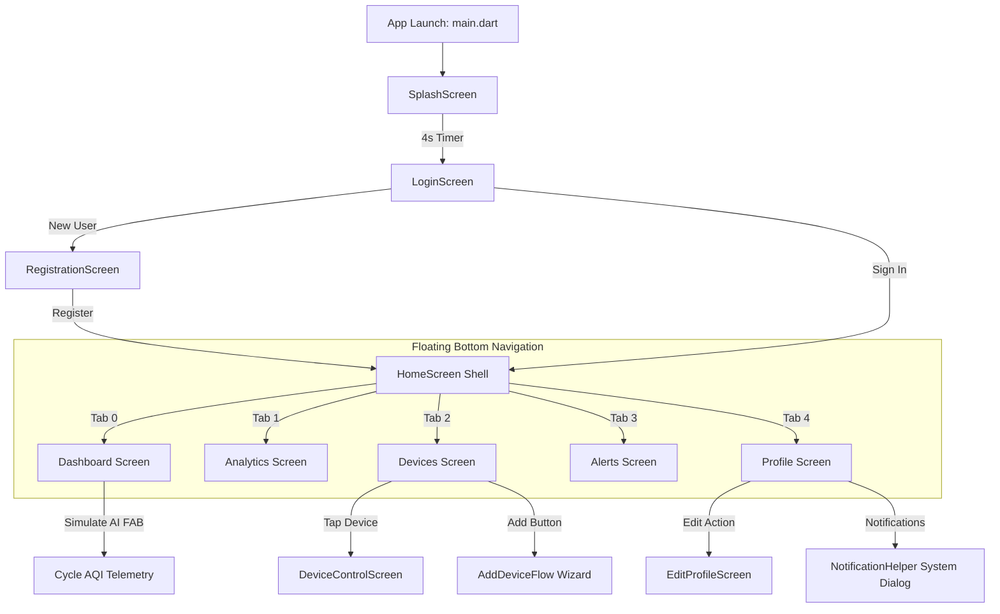

# Smart Home

<p align="center">
  
</p>

<p align="center">
  <strong>A Modern, AI-Driven IoT Air Quality Monitoring & Home Automation Dashboard built with Flutter.</strong>
</p>

<p align="center">
  <a href="https://flutter.dev"></a>
  <a href="https://dart.dev"></a>
  <a href="#prerequisites"></a>
  <a href="#license"></a>
  <a href="https://github.com/abhishekmghayal/Smart_Home"></a>
</p>

---

## Table of Contents

- [Project Overview](#project-overview)
- [Screenshots and Visual Assets](#screenshots-and-visual-assets)
- [Core Features](#core-features)
  - [1. Real-Time Air Quality & Telemetry Dashboard](#1-real-time-air-quality--telemetry-dashboard)
  - [2. Interactive AI Simulation Engine](#2-interactive-ai-simulation-engine)
  - [3. Device Hub & Control Screen](#3-device-hub--control-screen)
  - [4. Six-Stage IoT Onboarding Wizard](#4-six-stage-iot-onboarding-wizard)
  - [5. Historical & Predictive Analytics](#5-historical--predictive-analytics)
  - [6. Incident Alerts & Notifications](#6-incident-alerts--notifications)
  - [7. Profile & System Configuration](#7-profile--system-configuration)
- [Technology Stack](#technology-stack)
- [Application Architecture](#application-architecture)
  - [Directory Structure](#directory-structure)
  - [Application Flow](#application-flow)
- [Prerequisites](#prerequisites)
- [Installation and Setup](#installation-and-setup)
- [Configuration and Environment](#configuration-and-environment)
- [Usage Guide](#usage-guide)
- [API and Backend Integration](#api-and-backend-integration)
- [Testing](#testing)
- [Build and Deployment](#build-and-deployment)
- [Troubleshooting](#troubleshooting)
- [Security Practices](#security-practices)
- [Roadmap](#roadmap)
- [Contributing](#contributing)
- [License](#license)
- [Author and Contact](#author-and-contact)

---

## Project Overview

**Smart Home** is an ambient intelligence and home automation application designed to monitor indoor air conditions and control interconnected smart appliances. Modern homes frequently harbor elevated concentrations of unseen indoor air pollutants—such as fine particulate matter (PM2.5, PM10), carbon dioxide (CO₂), and volatile organic compounds (VOCs)—which degrade cognitive performance and respiratory health.

This project addresses indoor environmental hazards by providing:
- **Instant Visual Assessment:** Continuous Air Quality Index (AQI) evaluation with clear categorization (`Good`, `Moderate`, `Poor`, `Warning`, `Critical`) and actionable safety insights.
- **Predictive Foresight:** AI prediction indicators projecting environmental trends 6+ hours into the future.
- **Device Orchestration:** Direct toggles and deep parameter controllers for air purifiers, fans, air conditioners, smart bulbs, and network routers.
- **Dynamic Theming:** Ambient interface gradients and an animated canvas particle system that adapt in real time to current air safety levels.

The application is fully written in **Flutter** using native declarative state management, custom painting, and Cupertino/Material hybrid design components.

---

## Screenshots and Visual Assets

The project logo is maintained locally in the repository:

<p align="center">
  
  <br />
  <em>Smart Home Application Brand Icon (assets/images/img.png)</em>
</p>

### Interface Gallery

<!--
  To display live screenshots in this repository:
  1. Capture screenshots from the emulator or physical device.
  2. Place PNG images into an `assets/screenshots/` or `docs/screenshots/` directory.
  3. Replace the placeholder comment paths below with your saved image filenames.
-->

| Splash & Authentication | Air Dashboard | IoT Device Manager |
|:---:|:---:|:---:|
| <!--  --> *(Splash / Login Screen)* | <!--  --> *(Real-Time AQI & Telemetry)* | <!--  --> *(Device Toggles & Onboarding)* |

| Analytics & Predictions | Alert Timeline | User Profile |
|:---:|:---:|:---:|
| <!--  --> *(fl_chart Telemetry)* | <!--  --> *(Categorized Safety Alerts)* | <!--  --> *(Settings & Permissions)* |

---

## Core Features

### 1. Real-Time Air Quality & Telemetry Dashboard
- **Animated AQI Radial Gauge:** Custom arc meter visualizing the current AQI value with status labels and color codes (Green/Good, Yellow/Moderate, Orange/Poor, Red/Warning, Crimson/Critical).
- **Multi-Sensor Grid:** Real-time readings for **PM2.5** ($\mu\text{g/m}^3$), **CO₂** ($\text{ppm}$), **VOCs** ($\text{mg/m}^3$), **Humidity** ($\%$), **Temperature** ($^\circ\text{C}$), and **PM10** ($\mu\text{g/m}^3$).
- **Micro Sparkline Visualizations:** Each sensor card renders a sparkline showing recent trends.
- **Dynamic Risk Banner:** Context-sensitive hazard alerts automatically appear when AQI exceeds safe thresholds (>100), suggesting window closures or air purifier activation.
- **Interactive Particle Canvas:** A custom `CustomPainter` engine (`ParticleBackground`) renders 40 floating ambient particles matching the current air quality condition.

### 2. Interactive AI Simulation Engine
- Includes a built-in **"Simulate AI"** floating action button on the dashboard.
- Clicking the simulator cycles the system state across five distinct environmental severity levels:
  $$\text{Good } (30) \longrightarrow \text{Moderate } (85) \longrightarrow \text{Poor } (145) \longrightarrow \text{Warning } (180) \longrightarrow \text{Critical } (250)$$
- Triggers instant reactive recalculations across sensor values, UI theme gradients, risk banners, and predictive advisories.

### 3. Device Hub & Control Screen
- **Staggered Device Control Hub:** Monitor and switch connected appliances:
  - **Smart Fan:** Power toggle and active speed profile (`Low`, `Medium`, `High`, `Breeze`).
  - **Smart Bulb:** Power state, color preset picker, and interactive brightness slider ($0\% - 100\%$).
  - **Air Purifier:** Power switch, active mode (`Auto`, `Silent`, `Turbo`), and filter longevity tracker.
  - **Air Conditioner (AC):** Power switch, temperature stepper ($16^\circ\text{C} - 30^\circ\text{C}$), and modes (`Cool`, `Dry`, `Fan`, `Auto`).
- **Dedicated Device Deep-Dive (`DeviceControlScreen`):** Tapping any device card opens full hardware parameters, including network connection metrics, timer schedules, and calibration settings.

### 4. Six-Stage IoT Onboarding Wizard
The `AddDeviceFlow` wizard provides a structured pairing state machine:
1. **Options:** Select between automated Bluetooth/Wi-Fi discovery and manual entry.
2. **Scanning:** Radar pulse animation scanning for broadcast signals.
3. **Connecting:** Simulated cryptographic handshake protocol with delay timers.
4. **Success:** Hardware confirmed and assigned to a designated room.
5. **Error:** Automatic retry and failure diagnosis fallback.
6. **Manual Entry:** Direct entry for SSID, network security key, and hardware MAC/Serial.

### 5. Historical & Predictive Analytics
- Integrated with `fl_chart` for dual-line graph rendering.
- Displays both **historical telemetry** (solid curved lines) and **AI predictive forecasts** (dashed curved lines).
- Metric filter selector allowing users to switch between **AQI**, **PM 2.5**, **CO₂**, and **Temperature**.
- Summary analytics detailing peak reading periods, diurnal stability, and baseline averages.

### 6. Incident Alerts & Notifications
- Centralized event feed grouped into four severity tiers: `Critical`, `Warning`, `Success`, and `Info`.
- Relative timestamp indicators (`2 min ago`, `1 hr ago`, `Yesterday`).
- Interactive dismiss and alert-filtering capabilities.

### 7. Profile & System Configuration
- **User Identity:** Profile card displaying account name, contact email, and active role.
- **AI Automation Controls:** Switches for *Enable AI Predictions*, *Auto Suggestions*, and a 3-stage *Alert Sensitivity* segmented control (`Low`, `Medium`, `High`).
- **Notification Lifecycle Manager:** `NotificationHelper` coordinates Android and iOS runtime permissions (`permission_handler`) and remembers prompt interactions via `shared_preferences`.
- **Profile Editor (`EditProfileScreen`):** Full form with dirty-state change tracking for modifying name, address, password, and avatar selections.

---

## Technology Stack

| Technology / Package | Version Constraint | Verified Project Role | Implementation Location |
|---|---|---|---|
| **Flutter SDK** | `^3.10.8` (Tested on `3.44.2`) | Cross-platform UI toolkit and runtime | Entire project |
| **Dart SDK** | `^3.10.8` (Tested on `3.12.2`) | Core programming language | `lib/` |
| **cupertino_icons** | `^1.0.8` | iOS-styled iconography | `lib/widgets/` |
| **font_awesome_flutter** | `^11.0.0` | Environmental and IoT hardware icons | `lib/home_screen.dart`, `lib/screens/auth/` |
| **fl_chart** | `^1.2.0` | Line and trend chart visualization | `lib/screens/tabs/analytics_screen.dart` |
| **animated_text_kit** | `^4.3.0` | Micro-interaction typography animations | Project dependency |
| **permission_handler** | `^12.0.1` | Native runtime permission requests (Notifications) | `lib/utils/notification_helper.dart` |
| **shared_preferences** | `^2.5.5` | Key-value persistent local storage | `lib/utils/notification_helper.dart` |
| **flutter_lints** | `^6.0.0` | Static analysis rules for clean code | `analysis_options.yaml` |
| **flutter_test** | SDK | Automated widget and smoke test framework | `test/widget_test.dart` |

---

## Application Architecture

### Directory Structure

```text
Smart_Home/
├── android/                        # Android native host project (Gradle 8.14, AGP 8.11.1)
├── ios/                            # iOS native host project
├── macos/                          # macOS desktop runner
├── linux/                          # Linux desktop runner
├── windows/                        # Windows desktop runner
├── web/                            # Web platform runner
├── assets/
│   └── images/
│       └── img.png                 # Application logo asset
├── lib/
│   ├── main.dart                   # Application entry point & theme initialization
│   ├── splash_screen.dart          # Timed animated splash screen with logo transitions
│   ├── home_screen.dart            # Main shell with animated particle layer & tab router
│   ├── screens/
│   │   ├── auth/
│   │   │   ├── login_screen.dart          # Form-validated sign-in & social OAuth UI
│   │   │   └── registration_screen.dart   # Multi-field user registration form
│   │   ├── devices/
│   │   │   ├── add_device_flow.dart       # 6-step IoT onboarding wizard
│   │   │   └── device_control_screen.dart # Deep-dive hardware parameter controller
│   │   ├── profile/
│   │   │   └── edit_profile_screen.dart   # Profile details & address editor
│   │   └── tabs/
│   │       ├── analytics_screen.dart      # fl_chart historical vs. predictive charts
│   │       ├── devices_screen.dart        # Grid of connected hardware toggles
│   │       ├── alerts_screen.dart         # Categorized incident feed
│   │       └── profile_screen.dart        # Account settings, AI switches & logout
│   ├── utils/
│   │   ├── aqi_helper.dart                # AQI calculation models & color mappings
│   │   └── notification_helper.dart       # Runtime permission & preference handling
│   └── widgets/
│       ├── custom_text_field.dart         # Reusable form field component
│       ├── glass_card.dart                # Frosted glassmorphism card (BackdropFilter)
│       ├── social_login_button.dart       # Styled OAuth button components
│       ├── animations/
│       │   └── particle_background.dart   # CustomPainter canvas particle engine
│       └── dashboard/
│           ├── ai_status_card.dart        # AI forecast commentary card
│           ├── animated_aqi_meter.dart    # Arc/radial AQI meter widget
│           ├── custom_bottom_nav.dart     # Navigation icon builder
│           ├── floating_bottom_nav.dart   # Frosted floating navigation bar
│           ├── main_aqi_card.dart         # Primary hero card on dashboard
│           ├── metric_card.dart           # Sensor card with embedded sparkline
│           ├── risk_alert_banner.dart     # Dynamic high-AQI warning banner
│           └── sparkline_graph.dart       # Canvas sparkline renderer
├── test/
│   └── widget_test.dart            # Automated smoke test verifying app launch
├── analysis_options.yaml           # Analyzer configuration (flutter_lints)
├── pubspec.yaml                    # Package manifest & asset declarations
└── pubspec.lock                    # Locked dependency versions
```

### Application Flow



---

## Prerequisites

Before building or running the project, verify that the following tools are installed:

- **Flutter SDK:** Version `3.10.8` or newer (Tested with stable `3.44.2`).
- **Dart SDK:** Version `3.10.8` to `<4.0.0` (Included with Flutter).
- **Java Development Kit (JDK):** **JDK 17** or **JDK 21** is **required** for Android builds.
  > **Note regarding Java 25:** Gradle 8.14 and its embedded Kotlin DSL do not support JDK 25 and will fail with `IllegalArgumentException`. Always use JDK 17 or JDK 21.
- **Android Studio / Android SDK:** Platform SDK 34–36, Command-line Tools, and Build-Tools.
- **Android Device or Emulator:** Running Android 8.0 (API 26) or higher.
- **Git:** Version control client.

---

## Installation and Setup

### 1. Clone the Repository

```bash
git clone https://github.com/abhishekmghayal/Smart_Home.git
cd Smart_Home
```

### 2. Verify Development Environment

Run `flutter doctor` to ensure all toolchains are properly discovered:

```bash
flutter doctor
```

*(Ensure Android toolchain, connected devices, and SDKs show green checkmarks.)*

### 3. Configure JDK Path (If Needed)

If your machine defaults to JDK 25 or an unsupported Java version, configure Flutter to target your OpenJDK 17 or 21 installation:

```bash
# Example for macOS with Homebrew OpenJDK 21:
flutter config --jdk-dir="/opt/homebrew/opt/openjdk@21"
```

Accept any pending Android SDK licenses:

```bash
yes | flutter doctor --android-licenses
```

### 4. Install Dependencies

Fetch all packages declared in `pubspec.yaml`:

```bash
flutter pub get
```

### 5. Launch the Application

Connect an Android device or start an Android emulator, then run:

```bash
flutter run
```

To run specifically on a designated device ID:

```bash
flutter devices
flutter run -d <DEVICE_ID>
```

---

## Configuration and Environment

- **No Remote Secrets Required:** The current repository does not require `.env` files, API keys, or Firebase credentials to launch.
- **Local Simulation:** Sensor values, simulated Bluetooth handshakes, and credential verification are self-contained within client-side state models.
- **Runtime Persistence:** User notification permissions are saved to disk via `SharedPreferences`. Clearing app storage resets first-launch flags.

---

## Usage Guide

### Logging In
1. On app start, the animated **Splash Screen** plays for 4 seconds before redirecting to the **Login Screen**.
2. **Username:** Enter any username or email (e.g., `admin`, `alex`, or your name).
3. **Password:** Enter any non-empty password (e.g., `123456`).
4. Check the box: **"I agree to the Privacy Policy & User Agreement"**.
5. Tap **Login**.

### Exploring the Dashboard
- **Viewing Air Metrics:** Inspect the large AQI meter for overall status. Review cards for PM2.5, CO₂, VOCs, Temperature, and Humidity.
- **Simulating Air Fluctuations:** Click the **"Simulate AI"** button at the bottom-left of the Dashboard. Notice how the background gradient, risk banner, particle colors, and telemetry graphs adapt dynamically.

### Managing Hardware
- Navigate to the **Devices** tab (3rd icon).
- Toggle switches on each card to power devices on or off.
- Tap any card to open the **Device Control Screen** for fine-grained adjustments (e.g., bulb brightness slider, AC temperature controls).
- Click **Add Device** to walk through the pairing radar wizard.

### Reviewing Trends and Alerts
- Navigate to the **Analytics** tab (2nd icon) to switch between AQI, PM2.5, CO₂, and Temperature trend graphs.
- Navigate to the **Alerts** tab (4th icon) to see incident histories, warnings, and connection confirmations.

---

## API and Backend Integration

The application currently operates with an **in-memory mock service layer**:

- **Telemetry Generation:** Sensor values and sparkline arrays are generated dynamically in `HomeScreenState._generateTrend()` based on active AQI baseline numbers.
- **Authentication:** Simulated in `_LoginScreenState._handleLogin()` and `_RegistrationScreenState._handleRegister()` using artificial asynchronous network delays (`Future.delayed`).
- **IoT Pairing Handshake:** Simulated in `_AddDeviceFlowState._connectToDevice()` with realistic connection latency.

*No external HTTP endpoints or Firebase databases are connected in the current codebase.*

---

## Testing

The project includes an automated widget smoke test in `test/widget_test.dart` that boots the widget tree, validates the splash screen header, advances the animation timers, and verifies clean disposal:

To run all automated tests:

```bash
flutter test
```

To verify code quality and ensure zero static analysis warnings:

```bash
flutter analyze
```

*Expected output: `No issues found!`*

---

## Build and Deployment

### Android APK (Debug)
Used for testing on local devices:

```bash
flutter build apk --debug
```
*Output artifact:* `build/app/outputs/flutter-apk/app-debug.apk`

### Android APK (Release)
Produces an optimized, stripped release binary:

```bash
flutter build apk --release
```
*Output artifact:* `build/app/outputs/flutter-apk/app-release.apk`

### Android App Bundle (AAB)
Recommended format for Google Play Store distribution:

```bash
flutter build appbundle --release
```
*Output artifact:* `build/app/outputs/bundle/release/app-release.aab`

---

## Troubleshooting

### 1. Build Failure: `IllegalArgumentException: 25.0.2 / 25.0.3`
- **Cause:** Android Studio or the host system is running Java 25. Gradle 8.14 and Kotlin DSL scripts cannot parse Java 25 version strings.
- **Solution:** Install OpenJDK 21 (`brew install openjdk@21` on macOS) and run:
  ```bash
  flutter config --jdk-dir="/opt/homebrew/opt/openjdk@21"
  ```

### 2. Android SDK Licenses Not Accepted
- **Error:** `Some Android licenses not accepted. To resolve this, run: flutter doctor --android-licenses`
- **Solution:** Execute:
  ```bash
  yes | flutter doctor --android-licenses
  ```

### 3. Missing Notification Permission on Android 13+
- **Behavior:** The initial notification dialog was dismissed or denied.
- **Solution:** Open the **Profile** tab, tap **Notification Settings**, and select **Allow Notifications**. If previously permanently denied, use the prompt's **Open Settings** button to enable permissions in device settings.

---

## Security Practices

- **Zero Hardcoded Secrets:** No API keys, database credentials, or private access tokens are checked into version control.
- **Safe State Lifecycle:** Timers and animation controllers across all screens are cancelled in `dispose()` to prevent memory leaks.
- **Keystore Protection:** `.gitignore` excludes `*.keystore`, `*.jks`, and `key.properties`. Never commit production Android release signing keys.

---

## Roadmap

Proposed future enhancements for subsequent releases:
- [ ] **MQTT / WebSocket Protocol Integration:** Connect real physical IoT sensors (ESP32, Raspberry Pi, Home Assistant).
- [ ] **Cloud Backend:** Synchronize user telemetry and device state using a RESTful API or Firebase Firestore.
- [ ] **Push Notifications:** Dispatch native background push alerts via Firebase Cloud Messaging (FCM) when AQI surpasses hazardous thresholds.
- [ ] **Automated Scheduling:** Set automated device rules (e.g., "Turn on Air Purifier when PM2.5 > 35").
- [ ] **Multi-Room Support:** Categorize devices across multiple rooms (Living Room, Bedroom, Office).

---

## Contributing

Contributions, feedback, and pull requests are welcome!

1. Fork the Project:
   ```bash
   git fork https://github.com/abhishekmghayal/Smart_Home.git
   ```
2. Create your Feature Branch:
   ```bash
   git checkout -b feature/NewFeature
   ```
3. Commit your Changes:
   ```bash
   git commit -m "Add NewFeature"
   ```
4. Run Tests & Lint:
   ```bash
   flutter analyze
   flutter test
   ```
5. Push to the Branch:
   ```bash
   git push origin feature/NewFeature
   ```
6. Open a Pull Request.

---

## License

No license has been specified for this repository. All rights are reserved by the author. To use, modify, or distribute this software commercially or privately, explicit permission or an open-source license must be granted by the copyright holder.

---

## Author and Contact

- **Author:** Abhishek Ghayal
- **GitHub Repository:** [https://github.com/abhishekmghayal/Smart_Home](https://github.com/abhishekmghayal/Smart_Home)
- **Project Name:** Smart Home (Flutter)
